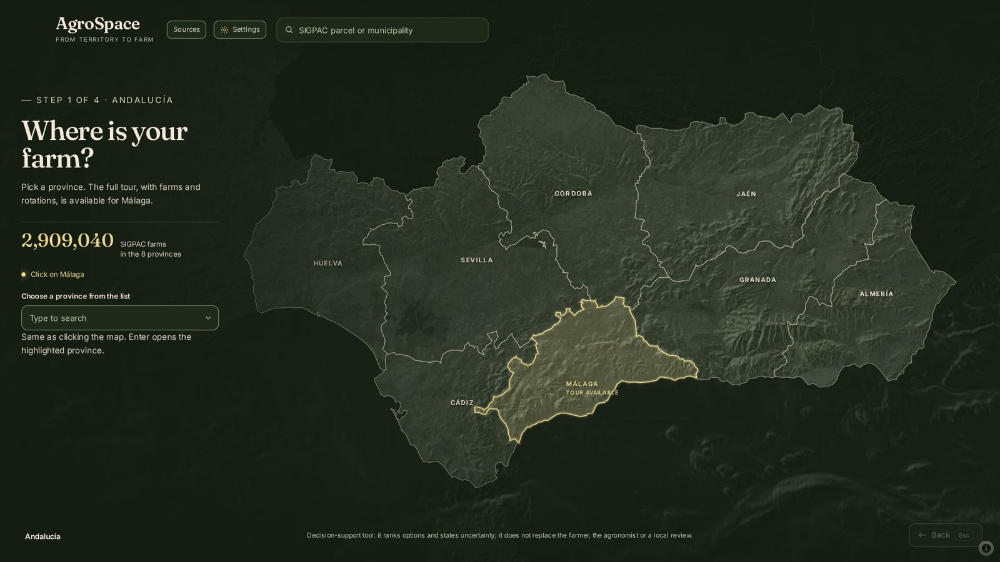
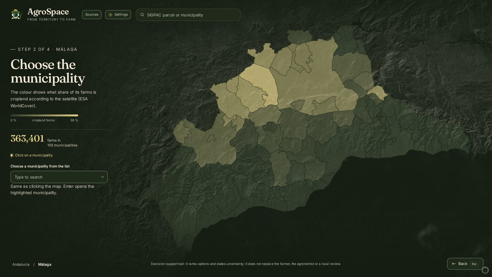
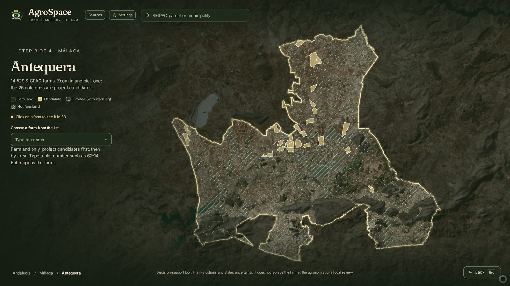
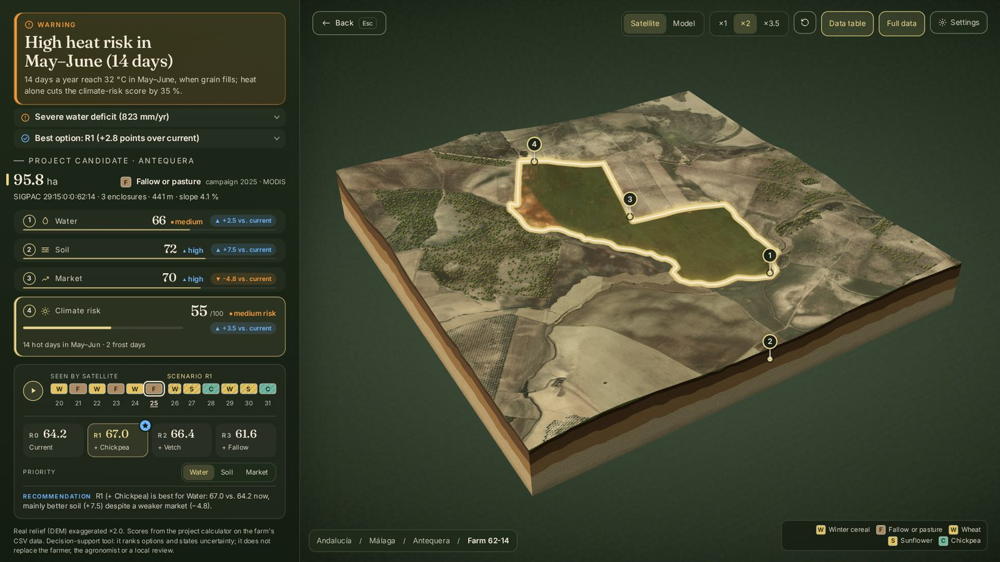
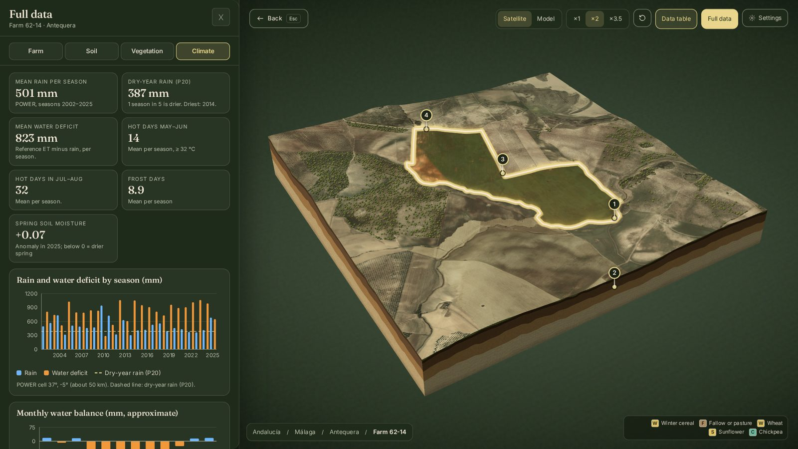
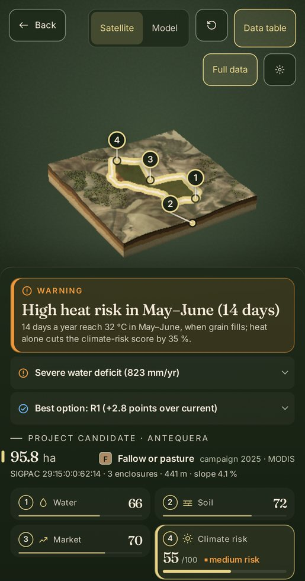

<p align="center">
  
</p>

<p align="center">
  <b>From territory to farm.</b><br>
  Satellite, climate and soil data to choose the next crop rotation for any farm in Málaga.
</p>

<p align="center">
  <a href="https://agrospace-w8ej.onrender.com/"><b>▶ Live demo</b></a> ·
  <a href="assets/video/agrospace-demo.mp4">30-second video</a> ·
  <a href="#run-it-locally">Run it locally</a>
</p>

---

**AgroSpace** is our entry for the **Space Apps Challenge Málaga 2026**, challenge 06
*Field Shift: Adapting Farms with Space Data* ([spaceappschallenge.org](https://www.spaceappschallenge.org/)).
It takes a farmer from the whole region down to one farm and answers one question with
open data: **what should this field grow next?**

It is a decision-support tool: it ranks rotation options and states its uncertainty; it
does not replace the farmer, the agronomist or a field visit.

**Live demo:** <https://agrospace-w8ej.onrender.com/>

## Screenshots

| | |
|:--:|:--:|
|  |  |
| **1 · Andalucía** · 2,909,040 SIGPAC farms in 8 provinces | **2 · Málaga** · 103 municipalities, shaded by cropland |
|  |  |
| **3 · Antequera** · 14,529 farms; the 26 gold ones are project candidates | **4 · One farm** · real relief in 3D, risks first, then the best rotation |
|  |  |
| **Full data** · farm, soil, vegetation and climate | **On a phone** · map first; the 3D stays still to save battery |

## What it does

- **A guided journey:** Andalucía → Málaga → municipality → farm, by clicking the map,
  with keyboard lists, or by typing a SIGPAC reference into the search.
- **One farm at a time:** its own terrain in 3D, the risks that matter first (heat,
  water deficit, steep slope…) and four rotations compared on **water, soil, market and
  climate risk**: R0 the current one (wheat–sunflower), R1 + chickpea, R2 + vetch and
  R3 + fallow, with the best one for the priority you choose.
- **Explainable:** weighted rules, not a black box. The scores in the browser match the
  data pipeline exactly (1,144 values, 0 differences), and the water score is checked
  against what the satellite saw (NDVI).
- **For everyone, on any screen:** the whole journey works with a keyboard or a screen
  reader; text up to 150 %, high contrast, reduced motion, a "3D off" mode for slow
  devices, and a phone layout.

## Data

| Layer | Source | Detail |
|---|---|---|
| Farms | SIGPAC (FEGA) | 2.9 M parcels in Andalucía |
| Vegetation | MODIS NDVI | 250 m, seasons 2020–2025 |
| Climate | POWER Project, Langley Research Center | daily, seasons 2002–2025 |
| Soil | SoilGrids 2.0 (ISRIC) | 250 m, top 100 cm |
| Land cover | ESA WorldCover | 10 m |
| Relief | SRTM-derived DEM | slope and 3D terrain |
| Prices | Eurostat, MAPA | wheat, sunflower, chickpea, vetch |

The data is precomputed by the Python pipeline and shipped with the app
(`app/public/data/`), so the demo needs **no backend and no API keys**. Map imagery,
elevation tiles and the live monthly climate are loaded by the browser from public
services.

## Run it locally

**You need:** [Git](https://git-scm.com/) and [Node.js 24](https://nodejs.org/) (it comes
with npm). Python is only needed to rebuild the data.

1. **Get the code**

   ```bash
   git clone https://github.com/jesus1516/Ciberpiso.git
   cd Ciberpiso/app
   ```

2. **Install the dependencies**

   ```bash
   npm ci
   ```

3. **Start it** and open <http://localhost:5173>

   ```bash
   npm run dev
   ```

4. **Production build** (what the live demo serves), then open <http://localhost:4173>

   ```bash
   npm run build
   npm run preview
   ```

5. **On your phone** (optional, same Wi‑Fi): serve it on the network and open
   `http://<your-computer-ip>:4173` on the phone.

   ```bash
   npm run preview -- --host 0.0.0.0
   ```

6. **Run the checks** (optional)

   ```bash
   npx tsc -b                                # types
   npm run test                              # 182 unit tests (Vitest)
   node scripts/check-calculator.ts          # calculator = pipeline, 0 differences
   npx playwright install --only-shell chromium
   E2E_BROWSER=chromium npm run test:e2e     # 123 browser tests, about 20 minutes
   ```

   Details: [docs/testing.md](docs/testing.md).

### Rebuild the data (optional)

```bash
python3 -m venv .venv && source .venv/bin/activate
pip install -r pipeline/requirements.txt
python3 pipeline/cargar_sqlite.py malaga      # CSV → SQLite for Málaga (~10 s)
```

The full pipeline (download, scoring, export to the app) is described step by step in
[data/README.md](data/README.md) and [docs/fuentes-scraping.md](docs/fuentes-scraping.md).

## Repository

```
app/        the web app: React + TypeScript + Vite, MapLibre GL, three.js
pipeline/   Python pipeline that downloads, scores and exports the data
data/       CSV and SQLite data for Málaga and Andalucía
docs/       testing, performance, data sources, architecture, validation
assets/     logo and the 30-second demo video
tests/      pipeline tests (pytest)
```

| Document | What it contains |
| --- | --- |
| [App](app/README.md) | How the web app is built: explorer, rotation engine, data. |
| [Testing](docs/testing.md) | Every test suite and how to run it. |
| [Performance](docs/performance.md) | Measurements on slow computers and what was optimised. |
| [Example rotations](docs/rotaciones.md) | The four strategies with evidence, benefits, gaps and risks. |
| [Data sources](docs/fuentes-de-datos.md) | What each source offers, resolution, access and limits. |
| [Data pipeline](docs/fuentes-scraping.md) | Sources, CSV, SQLite and gaps. |
| [Data access](docs/acceso-datos.md) | Verified API examples, caching and harmonisation. |
| [Architecture](docs/arquitectura.md) | Data contracts and scoring model. |
| [Validation](docs/validacion.md) | Checks done, limits and what still needs field validation. |
| [Andalucía viability](docs/andalucia-viability.md) | What it takes to open the farm view for all of Andalucía. |
| [Data](data/README.md) | Data model, CSV and SQLite. |

## What it is not

- Not an agronomic prescription for a plot.
- Not a replacement for the farmer, the agronomist or field data.
- Not field-level climate: POWER cells are about 50 km wide.

## Credits

- **Data:** SIGPAC (FEGA), POWER Project (Langley Research Center), MODIS, SoilGrids
  (ISRIC), ESA WorldCover, SRTM-derived DEM, Eurostat and MAPA. Each document states its
  source, licence and terms of use.
- **Challenge:** Space Apps Challenge Málaga 2026 · challenge 06 *Field Shift* ([spaceappschallenge.org](https://www.spaceappschallenge.org/)).
- **AI disclosure:** an AI coding assistant (Claude, by Anthropic) helped write the code,
  the tests and the texts. The team chose the data, the method and the checks.
