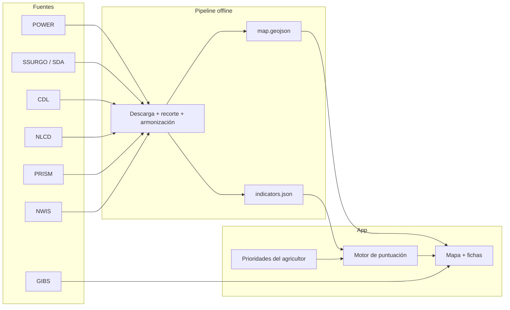

# Arquitectura y modelo de datos

Diseño pensado para un hackathon: **datos precalculados**, **puntuación explicable**
y **demo sin red**. La app no necesita un backend en vivo para funcionar.

## Principios

1. **Offline first.** Todo lo que se muestra está cacheado y versionado.
2. **Explicable.** Cada número tiene fuente, fecha, unidad y confianza.
3. **Separación de capas.** Pipeline de datos, motor de puntuación y UI se pueden
   probar por separado.
4. **Sin secretos en el cliente.** Las claves viven en el pipeline, nunca en el
   navegador.
5. **Una sola verdad.** `indicators.json` es la fuente de la verdad; la UI no
   recalcula datos crudos.

## Diagrama



## Componentes

### 1. Pipeline de datos (Python, offline)

Responsabilidades:

- Descargar el AOI de cada fuente.
- Recortar, reproyectar y agregar a una rejilla común.
- Calcular indicadores por rotación.
- Escribir `indicators.json`, `map.geojson` y `manifest.json`.
- Validar el esquema antes de publicar.

No se ejecuta en la demo. Se ejecuta antes y se versiona el resultado.

### 2. Motor de puntuación (TypeScript o Python)

Una función pura:

```text
score(rotation, profile) -> recommendation
```

No llama a APIs, no lee archivos y no depende del framework. Se puede testear con
tablas de casos.

### 3. UI (Next.js + MapLibre)

- Mapa con capas GIBS y el AOI.
- Panel de prioridades.
- Tarjetas comparables.
- Ficha de evidencia.
- Glosario y aviso legal.

### 4. Contenido

Las fichas de rotación pueden vivir en JSON/MDX para que el equipo de contenido no
toque el código. Cada ficha incluye los cinco campos obligatorios.

---

## Contrato de datos

### Tipos

```ts
type Priority = "water" | "soil" | "profit" | "risk";

interface FarmProfile {
  id: string;
  name: string;
  aoi: GeoJSON.Polygon;
  areaHa: number;
  soil: {
    texture: string;
    awc: number;          // fracción, documentar unidad
    drainage: string;
  };
  climate: {
    annualPrecipMm: number;
    frostFreeDays: number;
    heatDays: number;
  };
  constraints: {
    irrigation: boolean;
    machinery: string[];
    market: string[];
  };
  priorities: Record<Priority, number>; // 0–1, suma 1
}

interface Evidence {
  claim: string;
  source: string;
  url?: string;
  date?: string;
  strength: "high" | "medium" | "low";
}

interface Rotation {
  id: string;
  name: string;
  sequence: string[];
  years: number;
  rationale: string;
  benefits: string[];
  dataGaps: string[];
  reviewRisks: string[];
  evidence: Evidence[];
}

interface Indicator {
  id: string;
  label: string;
  value: number;
  unit: string;
  normalized: number;    // 0–1
  source: string;
  date: string;
  confidence: "high" | "medium" | "low";
  gap?: string;
}

interface Recommendation {
  rotationId: string;
  score: number;         // 0–1
  rank: number;
  confidence: number;    // 0–1
  contributions: Record<string, number>;
  benefits: string[];
  dataGaps: string[];
  reviewRisks: string[];
}
```

### Ejemplo de `indicators.json`

```json
{
  "aoi": "story-county-ia",
  "generated_at": "2026-11-14T12:00:00Z",
  "rotations": [
    {
      "id": "r1",
      "name": "Maíz–soja–avena + trébol rojo",
      "indicators": [
        {
          "id": "water",
          "label": "Balance hídrico de temporada",
          "value": 412,
          "unit": "mm",
          "normalized": 0.62,
          "source": "NASA POWER",
          "date": "2024-04-01/2024-09-30",
          "confidence": "medium",
          "gap": "No incluye ET medida en campo"
        }
      ]
    }
  ]
}
```

---

## Modelo de puntuación

### Fórmula

```text
score(r) = Σ_i  w_i · norm_i(r)
```

- `w_i`: peso de la prioridad `i`, definido por el agricultor. Suma 1.
- `norm_i(r)`: indicador normalizado a 0–1 entre las rotaciones comparadas.
- Si el indicador es "menos es mejor" (erosión, heladas), invierte la normalización:
  `1 - (x - min) / (max - min)`.

### Ejemplo

| Indicador | Peso | R0 | R1 | R2 | R3 |
| --- | --- | --- | --- | --- | --- |
| Agua | 0,35 | 0,55 | 0,60 | 0,50 | 0,45 |
| Suelo | 0,30 | 0,40 | 0,75 | 0,80 | 0,85 |
| Rentabilidad | 0,20 | 0,85 | 0,55 | 0,50 | 0,45 |
| Riesgo (invertido) | 0,15 | 0,80 | 0,60 | 0,60 | 0,35 |
| **Total** |  | **0,60** | **0,64** | **0,61** | **0,55** |

Los números son ilustrativos. Lo importante es que la UI muestre **por qué** R1 gana
y **qué pasaría** si el agricultor sube el peso de rentabilidad.

### Confianza

```text
confidence(r) = coverage(r) · evidence_strength(r)
```

- `coverage`: proporción de indicadores con dato (0–1).
- `evidence_strength`: alta = 1, media = 0,7, baja = 0,4.

Si falta CDL o SSURGO, la confianza baja. No se oculta: se muestra en la ficha.

### Reglas de honestidad

- No puntúes un indicador que no tienes. Márcalo como laguna.
- No mezcles observación y modelo sin etiquetarlos.
- No uses una puntuación alta para compensar datos faltantes.
- Muestra la contribución de cada indicador, no solo el total.

---

## Estructura del repo propuesta

```text
.
├── README.md
├── docs/
├── resources.json
├── pipeline/
│   ├── fetch/
│   ├── transform/
│   ├── indicators/
│   └── validate.py
├── data/
│   ├── raw/          # no versionar si es grande
│   ├── processed/    # sí versionar para la demo
│   └── manifest.json
├── app/
│   ├── app/
│   ├── components/
│   ├── lib/
│   └── public/
└── tests/
```

---

## Flujo de datos

1. **Selección del AOI.** Un condado o un polígono pequeño.
2. **Descarga.** Cada fuente a `data/raw/{source}/`.
3. **Armonización.** Clip, reproyección, resample y agregación documentada.
4. **Indicadores.** Una fila por rotación e indicador.
5. **Validación.** Esquema, rangos, cobertura y contraste.
6. **Publicación.** `indicators.json` + `map.geojson` + `manifest.json`.
7. **UI.** Lee los JSON; el mapa carga GIBS como raster.

---

## UI

### Pantallas

1. **Inicio:** explicación de 30 segundos y aviso de herramienta de apoyo.
2. **Perfil:** prioridades y restricciones.
3. **Mapa:** AOI, capas y leyenda.
4. **Comparación:** 2–3 rotaciones lado a lado.
5. **Ficha:** evidencia, beneficios, lagunas y revisión local.
6. **Glosario:** términos en lenguaje llano.

### Requisitos de contenido

- Cada tarjeta debe responder: "¿por qué esta rotación?".
- Cada número debe tener fuente y fecha.
- Cada recomendación debe incluir al menos una laguna y un riesgo.
- El aviso "no sustituye la revisión local" debe estar siempre visible.

### Rendimiento

- No cargues GeoJSON enorme en el cliente; usa PMTiles o simplifica.
- Las teselas GIBS se cargan bajo demanda; no precargues el mundo.
- Si GIBS da problemas de CORS, usa un proxy o capturas pre-renderizadas para la
  demo.

---

## Despliegue

### Opción A: estático (recomendada)

- Next.js con export estático o Vercel.
- `data/processed` versionado.
- Sin backend, sin claves, sin latencia.

### Opción B: backend ligero

- FastAPI para recalcular si el usuario cambia el AOI.
- Cache en disco.
- No lo necesitas para la demo; añade complejidad.

---

## Testing

- **Unidad:** puntuación, normalización y confianza.
- **Datos:** esquema, rangos, nulos y cobertura.
- **E2E:** Playwright para el flujo "perfil → comparación → ficha".
- **Accesibilidad:** teclado y contraste.
- **Regresión:** un JSON de ejemplo que no cambie sin querer.

---

## Riesgos y mitigaciones

| Riesgo | Mitigación |
| --- | --- |
| API caída en la demo | Datos cacheados + modo avión |
| Datos incompletos | Mostrar laguna y bajar confianza |
| Sobreafirmar precisión | Etiquetar resolución y modelo |
| GIBS no es dato | Usar solo para visualizar |
| GeoJSON pesado | PMTiles o simplificación |
| Claves filtradas | Variables de entorno, `.gitignore` |
| Cambio de producto NASA | Fijar versión y fecha en el manifiesto |

## Alternativas

- **Streamlit:** más rápido si el equipo es solo Python; menos control visual.
- **Observable:** bueno para prototipos de visualización; menos app.
- **FastAPI + React:** útil si hay un backend real; no es necesario para 48 h.
