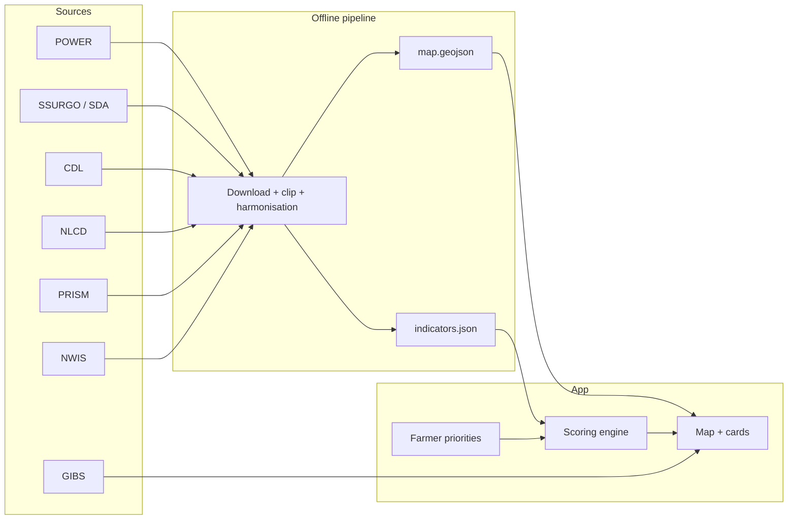

# Architecture and data model

Design aimed at a hackathon: **precomputed data**, **explainable scoring** and a
**demo without a network**. The app does not need a live backend to work.

## Principles

1. **Offline first.** Everything shown is cached and versioned.
2. **Explainable.** Every number has a source, date, unit and confidence.
3. **Layer separation.** The data pipeline, the scoring engine and the UI can be
   tested separately.
4. **No secrets in the client.** Keys live in the pipeline, never in the browser.
5. **Single source of truth.** `indicators.json` is the source of truth; the UI does
   not recompute raw data.

## Diagram



## Components

### 1. Data pipeline (Python, offline)

Responsibilities:

- Download the AOI from each source.
- Clip, reproject and aggregate to a common grid.
- Compute indicators per rotation.
- Write `indicators.json`, `map.geojson` and `manifest.json`.
- Validate the schema before publishing.

It does not run in the demo. It runs beforehand and the result is versioned.

### 2. Scoring engine (TypeScript or Python)

A pure function:

```text
score(rotation, profile) -> recommendation
```

It calls no APIs, reads no files and does not depend on the framework. It can be
tested with case tables.

### 3. UI (React + TypeScript + Vite, MapLibre GL, three.js)

- A guided explorer: Andalucía → Málaga → municipality → farm, by map, keyboard lists or SIGPAC search.
- The farm as a 3D block of real terrain, with the risks first (ranked insights).
- Indicator cards (water, soil, market, climate risk) and the four rotations, with a priority switch.
- A "Full data" drawer (farm, soil, vegetation, climate) and a data table.
- An accessibility layer (keyboard, screen reader, text size, contrast, reduced motion, 3D off).
- The rotation engine runs in the browser (`app/src/lib/calculator.ts`); see [app/README.md](../app/README.md).

### 4. Content

Rotation sheets can live in JSON/MDX so the content team does not touch the code.
Each sheet includes the five mandatory fields.

---

## Data contract

### Types

```ts
type Priority = "water" | "soil" | "profit" | "risk";

interface FarmProfile {
  id: string;
  name: string;
  aoi: GeoJSON.Polygon;
  areaHa: number;
  soil: {
    texture: string;
    awc: number;          // fraction, document the unit
    drainage: string;
  };
  climate: {
    annualPrecipMm: number;
    frostFreeDays: number;
    heatDays: number;
  };
  constraints: {
    irrigation: boolean;
    machinery: string[];
    market: string[];
  };
  priorities: Record<Priority, number>; // 0–1, sums to 1
}

interface Evidence {
  claim: string;
  source: string;
  url?: string;
  date?: string;
  strength: "high" | "medium" | "low";
}

interface Rotation {
  id: string;
  name: string;
  sequence: string[];
  years: number;
  rationale: string;
  benefits: string[];
  dataGaps: string[];
  reviewRisks: string[];
  evidence: Evidence[];
}

interface Indicator {
  id: string;
  label: string;
  value: number;
  unit: string;
  normalized: number;    // 0–1
  source: string;
  date: string;
  confidence: "high" | "medium" | "low";
  gap?: string;
}

interface Recommendation {
  rotationId: string;
  score: number;         // 0–1
  rank: number;
  confidence: number;    // 0–1
  contributions: Record<string, number>;
  benefits: string[];
  dataGaps: string[];
  reviewRisks: string[];
}
```

### `indicators.json` example

```json
{
  "aoi": "story-county-ia",
  "generated_at": "2026-11-14T12:00:00Z",
  "rotations": [
    {
      "id": "r1",
      "name": "Corn–soybean–oat + red clover",
      "indicators": [
        {
          "id": "water",
          "label": "Season water balance",
          "value": 412,
          "unit": "mm",
          "normalized": 0.62,
          "source": "POWER",
          "date": "2024-04-01/2024-09-30",
          "confidence": "medium",
          "gap": "Does not include field-measured ET"
        }
      ]
    }
  ]
}
```

---

## Scoring model

### Formula

```text
score(r) = Σ_i  w_i · norm_i(r)
```

- `w_i`: weight of priority `i`, set by the farmer. Sums to 1.
- `norm_i(r)`: indicator normalised to 0–1 across the compared rotations.
- If the indicator is "less is better" (erosion, frost), invert the normalisation:
  `1 - (x - min) / (max - min)`.

### Example

| Indicator | Weight | R0 | R1 | R2 | R3 |
| --- | --- | --- | --- | --- | --- |
| Water | 0.35 | 0.55 | 0.60 | 0.50 | 0.45 |
| Soil | 0.30 | 0.40 | 0.75 | 0.80 | 0.85 |
| Profitability | 0.20 | 0.85 | 0.55 | 0.50 | 0.45 |
| Risk (inverted) | 0.15 | 0.80 | 0.60 | 0.60 | 0.35 |
| **Total** |  | **0.60** | **0.64** | **0.61** | **0.55** |

The numbers are illustrative. What matters is that the UI shows **why** R1 wins and
**what would happen** if the farmer raised the weight of profitability.

### Confidence

```text
confidence(r) = coverage(r) · evidence_strength(r)
```

- `coverage`: share of indicators with data (0–1).
- `evidence_strength`: high = 1, medium = 0.7, low = 0.4.

If CDL or SSURGO is missing, confidence drops. It is not hidden: it is shown on the
sheet.

### Honesty rules

- Do not score an indicator you do not have. Mark it as a gap.
- Do not mix observation and model without labelling them.
- Do not use a high score to compensate for missing data.
- Show the contribution of each indicator, not only the total.

---

## Repository structure

```text
.
├── README.md
├── docs/            # documentation (this file, testing, performance, data sources…)
├── resources.json   # inventory of sources
├── pipeline/        # Python: download, harmonise, score, export
├── data/
│   ├── andalucia/   # CSV per province + SQLite schema and queries
│   ├── malaga/      # the Málaga copy the pipeline works on
│   ├── processed/   # indicators.json (versioned)
│   └── manifest.json
├── app/             # the web app (Vite); app/public/data holds the exported data
├── assets/          # logo and demo video
└── tests/           # pipeline tests (pytest)
```

---

## Data flow

1. **AOI selection.** A county or a small polygon.
2. **Download.** Each source to `data/raw/{source}/`.
3. **Harmonisation.** Clip, reprojection, resample and documented aggregation.
4. **Indicators.** One row per rotation and indicator.
5. **Validation.** Schema, ranges, coverage and cross-checking.
6. **Publication.** `indicators.json` + `map.geojson` + `manifest.json`.
7. **UI.** Reads the JSON files; the map loads GIBS as a raster.

---

## UI

### Screens

1. **Home:** 30-second explanation and support-tool notice.
2. **Profile:** priorities and constraints.
3. **Map:** AOI, layers and legend.
4. **Comparison:** 2–3 rotations side by side.
5. **Sheet:** evidence, benefits, gaps and local review.
6. **Glossary:** terms in plain language.

### Content requirements

- Each card must answer: "why this rotation?".
- Every number must have a source and date.
- Every recommendation must include at least one gap and one risk.
- The notice "does not replace local review" must always be visible.

### Performance

- Do not load huge GeoJSON in the client; use PMTiles or simplify.
- GIBS tiles load on demand; do not preload the world.
- If GIBS gives CORS problems, use a proxy or pre-rendered screenshots for the demo.

---

## Deployment

### Option A: static (what is deployed)

- The Vite production build of `app/` (`npm run build` → `app/dist/`), hosted on Render:
  <https://agrospace-w8ej.onrender.com/>.
- `data/processed` and `app/public/data` versioned.
- No backend, no keys, no latency.

### Option B: light backend (not used)

- FastAPI to recompute if the user changes the AOI.
- Disk cache.
- You do not need it for the demo; it adds complexity.

---

## Testing

- **Unit (Vitest):** calculator, insights, colour tokens, SIGPAC parsing; 182+ tests.
- **Calculator check:** the browser engine reproduces the pipeline (1,144 values, 0 differences).
- **E2E (Playwright):** the whole journey, layout at four screen sizes, keyboard, contrast, touch targets, settings.
- **Data (pytest):** pipeline exports and schema.
- Details and commands: [testing.md](testing.md).

---

## Risks and mitigations

| Risk | Mitigation |
| --- | --- |
| API down during the demo | Cached data + airplane mode |
| Incomplete data | Show the gap and lower confidence |
| Overstating precision | Label resolution and model |
| GIBS is not data | Use it only for visualisation |
| Heavy GeoJSON | PMTiles or simplification |
| Leaked keys | Environment variables, `.gitignore` |
| Change of a space-agency product | Pin version and date in the manifest |

## Alternatives considered (not used)

- **Streamlit:** faster if the team is Python-only; less visual control.
- **Observable:** good for visualisation prototypes; less of an app.
- **FastAPI + React:** useful if there is a real backend; not needed for 48 h.
